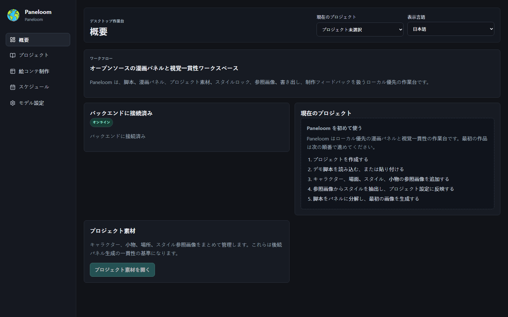

# Paneloom / 格织

[English](README.md) | [简体中文](README.zh-CN.md) | **日本語** | [한국어](README.ko.md)

Paneloom は、Windows ローカル優先・一人用の AI 漫画／アニメ絵コンテ制作デスクトップツールです。脚本、キャラクターとロケーションの参照素材、ビジュアルスタイル、絵コンテ、画像バージョン、ショットの承認とロック、書き出し、制作レビューを、移動可能な一つのローカルプロジェクトにまとめます。

**キーワード：** AI 漫画 · 絵コンテ · 漫画制作 · ビジュアル一貫性 · ローカル優先 · Windows デスクトップ · 画像生成 · FastAPI · React · pywebview

## 主な機能

- 脚本を読み込む、または貼り付けて、編集可能なショットへ分解。
- キャラクター、ロケーション、小物、スタイルの参照画像を管理。
- Bible、参照素材、ビジュアルスタイルの制約を画像生成リクエストへ反映。
- 画像の履歴バージョンを保存し、最終版を選択してショットを承認・ロック。
- JSON、CSV、XLSX、SRT、HTML、単体画像、漫画グリッド PNG を書き出し。
- プロジェクト全体をバックアップし、元のプロジェクトを上書きせずに復元。
- オフラインでもプロジェクト、脚本、絵コンテ、過去画像、ローカル書き出しを利用可能。

## ローカル優先

プロジェクトと制作素材は、既定でユーザーが選択したローカルフォルダーに保存されます。API キーは現在の Windows ユーザーの DPAPI で暗号化され、プロジェクトファイルやフロントエンド bundle には保存されません。AI 機能を明示的に実行した場合に限り、必要なプロンプトまたは参照画像が設定済みの外部モデルサービスへ送信されます。

## 現在の状態

`0.1.0-beta.1` は Windows ローカルデスクトップ Beta です。プロジェクトの移動、バックアップと復元、production-like pywebview/WebView2 起動、ランダムなループバックポート、正常終了を開発用 Windows 環境で検証済みです。無料のモデル利用枠は付属せず、互換性のあるテキスト／画像モデル API をユーザーが設定します。

現在のインストーラーは Authenticode 未署名で、独立したクリーンな Windows 10/11 環境での最終検証も未実施です。そのため、署名済み正式版として扱うことはできません。

## オープンソースと参加

- ライセンス：[MIT License](LICENSE)
- 開発・ビルド・検証の詳細：[English README](README.md)
- コントリビューションガイド：[CONTRIBUTING.md](CONTRIBUTING.md)
- 行動規範：[CODE_OF_CONDUCT.md](CODE_OF_CONDUCT.md)
- セキュリティポリシー：[SECURITY.md](SECURITY.md)
- サードパーティーライセンス：[THIRD_PARTY_LICENSES.md](THIRD_PARTY_LICENSES.md)
