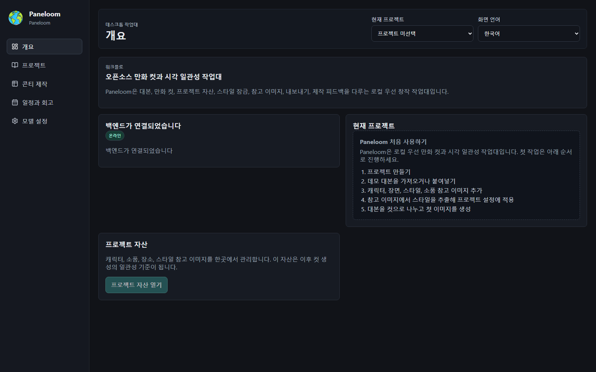

# Paneloom / 格织

[English](README.md) | [简体中文](README.zh-CN.md) | [日本語](README.ja.md) | **한국어**

Paneloom은 Windows 로컬 우선 방식으로 동작하는 1인 창작자용 AI 만화·애니메이션 콘티 데스크톱 도구입니다. 대본, 캐릭터와 장소 참고 자산, 시각 스타일, 콘티, 이미지 버전, 컷 승인과 잠금, 내보내기, 제작 회고를 이동 가능한 하나의 로컬 프로젝트에 정리합니다.

**키워드:** AI 만화 · 콘티 · 만화 제작 · 시각적 일관성 · 로컬 우선 · Windows 데스크톱 · 이미지 생성 · FastAPI · React · pywebview

## 주요 기능

- 대본을 가져오거나 붙여 넣어 편집 가능한 컷으로 분해합니다.
- 캐릭터, 장소, 소품, 스타일 참고 이미지를 관리합니다.
- Bible, 참고 자산, 시각 스타일 제약을 이미지 생성 요청에 반영합니다.
- 이미지 버전 기록을 저장하고 최종 버전을 선택한 뒤 컷을 승인하고 잠급니다.
- JSON, CSV, XLSX, SRT, HTML, 단일 이미지, 만화 그리드 PNG를 내보냅니다.
- 프로젝트 전체를 백업하고 원본 프로젝트를 덮어쓰지 않은 채 복원합니다.
- 오프라인에서도 프로젝트, 대본, 콘티, 기존 이미지와 로컬 내보내기를 사용할 수 있습니다.

## 로컬 우선

프로젝트와 창작 자산은 기본적으로 사용자가 선택한 로컬 폴더에 저장됩니다. API 키는 현재 Windows 사용자의 DPAPI로 암호화되며 프로젝트 파일이나 프런트엔드 bundle에 기록되지 않습니다. 사용자가 AI 기능을 직접 실행할 때만 필요한 프롬프트나 참고 이미지가 설정된 외부 모델 서비스로 전송됩니다.

## 현재 상태

`0.1.0-beta.1`은 Windows 로컬 데스크톱 Beta입니다. 프로젝트 이동, 백업과 복원, production-like pywebview/WebView2 실행, 임의 루프백 포트, 정상 종료를 개발용 Windows 환경에서 검증했습니다. 무료 모델 사용량은 포함되지 않으며 사용자가 호환되는 텍스트 및 이미지 모델 API를 직접 설정해야 합니다.

현재 설치 프로그램은 Authenticode 서명이 없고 독립적인 클린 Windows 10/11 환경에서 최종 검증하지 않았습니다. 따라서 서명된 정식 배포판으로 표현할 수 없습니다.

## 오픈 소스와 참여

- 라이선스: [MIT License](LICENSE)
- 개발·빌드·검증 상세 문서: [English README](README.md)
- 기여 가이드: [CONTRIBUTING.md](CONTRIBUTING.md)
- 행동 강령: [CODE_OF_CONDUCT.md](CODE_OF_CONDUCT.md)
- 보안 정책: [SECURITY.md](SECURITY.md)
- 서드파티 라이선스: [THIRD_PARTY_LICENSES.md](THIRD_PARTY_LICENSES.md)
