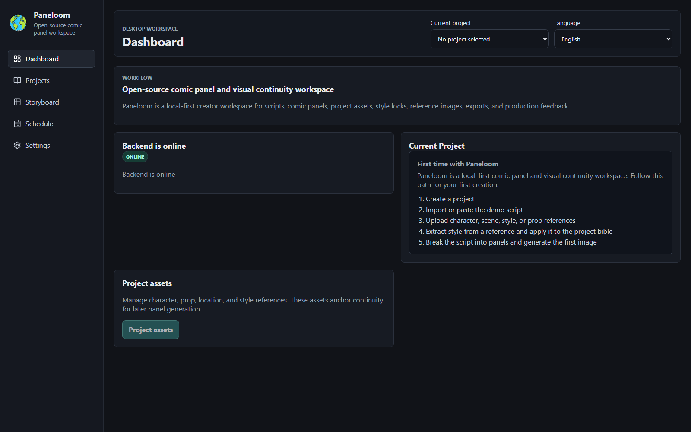

# Paneloom / 格织

**English** | [简体中文](README.zh-CN.md) | [日本語](README.ja.md) | [한국어](README.ko.md)

Paneloom is a Windows-local-first, single-user desktop creation tool for turning scripts into consistent comic panels with project assets, shot versions, approval locks, exports, and creator feedback loops.

Paneloom is not bundled with free model quota. You bring your own API key and choose the text, vision, and image models that fit your workflow.

Licensed under the MIT License.



## Current Status

Local desktop beta. Self-contained project folders, legacy migration, backup/restore, offline local editing, and the pywebview/WebView2 runtime are validated. A traceable unsigned Windows Beta installer has been built and exercised on the development Windows 11 machine. The binary is not committed to this repository and has not been validated on an independent clean Windows machine.

The frozen business source is `v0.1.0-beta.1-functional-baseline`. The open-source release line adds only packaging and release-compliance material; `release-source.json` records both immutable source identities. WEBTOON/Tapas submission-package work belongs to a later feature branch and is not part of this release.

## What It Does

- Manage local comic/story projects.
- Import scripts and narration drafts.
- Break scripts into storyboard shots and comic panels.
- Maintain a project bible for characters, locations, world notes, and visual style.
- Upload or generate reference assets for characters, props, locations, and style.
- Extract reusable style notes from reference images.
- Inject a strict STYLE LOCK into image prompts.
- Generate single panels or vertical comic strips.
- Export JSON, CSV, XLSX, SRT, HTML, single images, and comic grid PNGs.
- Track production schedules, work time, and social feedback screenshots.
- Keep creative data in user-selected, self-contained project folders with project-relative asset paths.

## Who It Is For

- Comic creators planning repeatable visual continuity.
- Writers turning scripts into panel-by-panel production plans.
- Solo creators making narrated comics or social comic posts.
- Developers who want a local-first, bring-your-own-key creative workflow app.

## Local Development

Requirements:

- Python 3.11+
- Node.js 20+
- npm

Install backend dependencies from the repository root:

```powershell
python -m venv .venv
.\.venv\Scripts\python.exe -m pip install --upgrade pip==26.1.2
.\.venv\Scripts\python.exe -m pip install -r backend\requirements.txt
```

Install frontend dependencies:

```powershell
cd frontend
npm install
```

Run the backend:

```powershell
.\.venv\Scripts\python.exe -m uvicorn backend.main:app --reload --host 127.0.0.1 --port 8000
```

Run the frontend:

```powershell
cd frontend
npm run dev
```

Open:

```text
http://127.0.0.1:5173
```

Windows local browser-workspace launcher (not a desktop application shell):

```powershell
.\scripts\start_desktop_dev.ps1
```

Windows native-window architecture prototype for developers only:

```powershell
python -m venv .desktop-venv
.\.desktop-venv\Scripts\python.exe -m pip install --upgrade pip==26.1.2
.\.desktop-venv\Scripts\python.exe -m pip install -r desktop\requirements.txt
cd frontend
npm run build
cd ..
.\scripts\start_desktop_prototype.ps1
```

The prototype uses pywebview/WebView2, serves the production React build and FastAPI API from one random `127.0.0.1` port, prevents duplicate instances, and closes the local service with the window.

Production-like desktop validation, using the built Vite application without a dev server:

```powershell
.\scripts\start_desktop_production_like.ps1
```

This entry starts the native window and local backend automatically. It still depends on the prepared developer runtime in `.desktop-venv` and therefore is not an end-user distribution package.

## Windows Beta Packaging

The reproducible Windows packaging path is documented in `packaging/README.md`. It requires a clean worktree and refuses business-source changes relative to the frozen functional tag.

```powershell
python -m venv .desktop-venv
.\.desktop-venv\Scripts\python.exe -m pip install --upgrade pip==26.1.2
.\.desktop-venv\Scripts\python.exe -m pip install -r requirements-lock.txt
.\scripts\build_windows_installer.ps1
```

The installer is currently unsigned. Do not remove SmartScreen warnings or describe it as a signed production release. The exact locally validated Beta artifact identity is recorded in `docs/windows_installer_validation_2026-07-20.md`.

## Quick Start: 10-Minute First Run

After the backend and frontend are running, you can try the core workflow with
the included fictional demo:

1. Open `http://127.0.0.1:5173`.
2. Create a new project from the Projects page.
3. Open the Storyboard page.
4. Paste `examples/demo-script.txt` into the script box, or use
   `examples/demo-project/script.txt`.
5. Run script breakdown to create panels.
6. Add your own character/style reference image, or continue without references.
7. Optionally extract style from a reference image and apply it to the project.
8. Generate the first panel image with your configured image model.

`examples/demo-project/` also shows the shape of a small project concept with
fictional `script.txt`, `characters.json`, `style.json`, and `shots.json` files.
It is not imported automatically; it is there so new contributors can understand
the project structure quickly.

The demo does not include copyrighted images, real project data, API keys, or
generated assets.

## Screenshots

The repository includes real production-build dashboard captures for every
documented interface language:

- [Simplified Chinese](docs/screenshots/zh-CN-dashboard.png)
- [English](docs/screenshots/en-dashboard.png)
- [Japanese](docs/screenshots/ja-dashboard.png)
- [Korean](docs/screenshots/ko-dashboard.png)

They are generated against an empty isolated data directory by
`scripts/capture_readme_screenshots.py`. They contain no private projects,
API keys, placeholder mock results, or user assets.

## Environment Variables

Use the Settings page or export these values into the backend process environment.
`.env.example` is a reference template; the backend does not auto-load a local `.env` file.
Do not commit real API keys.

Common variables:

```text
OPENAI_API_KEY=
OPENAI_BASE_URL=
OPENAI_PROVIDER_TYPE=custom
TEXT_PROVIDER=gpt
TEXT_PROVIDER_MODE=native
TEXT_BASE_URL=
TEXT_API_KEY=
TEXT_MODEL=gpt-5.5
IMAGE_MODEL=gpt-image-2
IMAGE_QUALITY=low
IMAGE_RESULT_MODE=auto
VITE_API_BASE_URL=http://127.0.0.1:8000
```

Settings are read in this order:

1. `%LOCALAPPDATA%\Paneloom\config\settings.json`, with API keys encrypted for the current Windows user through DPAPI.
2. Environment variables.
3. Clear API errors if no usable settings exist.

Image dimensions are selected in the storyboard workspace from the requested
output ratio. There is no global image-size setting that overrides a project's
workspace choice.

## Model API Configuration

Paneloom supports official OpenAI and custom OpenAI-compatible endpoints for image generation. Text workflows can use GPT/OpenAI-compatible, GLM, or Google/Gemini style configurations through the Settings page.

Generation quality, latency, timeout behavior, and reference-image support depend on your configured provider. Some relays do not fully support image edits with uploaded reference images.

## Supported Script Import Formats

- TXT
- MD
- SRT
- CSV
- PDF
- DOCX
- EPUB
- RTF
- HTML
- XLSX

Scanned PDFs need OCR before import.

## Supported Export Formats

- JSON
- CSV
- XLSX
- SRT
- HTML
- Single generated images
- Comic grid PNG

## Data Locations

- New projects: a user-selected folder, or `Documents\Paneloom Projects\<project-name>-<id>\` by default.
- Project metadata and workspaces: inside the project root.
- Reference assets: `<project>\assets\references\`.
- Generated images and versions: `<project>\generated\`.
- Exports: `<project>\exports\`.
- Project backups: `<project>\backups\`, or another user-selected folder.
- Settings and DPAPI-encrypted API keys: `%LOCALAPPDATA%\Paneloom\config\`.
- Project registry, migration logs, cache, logs, and temporary files: `%LOCALAPPDATA%\Paneloom\`.
- Legacy repository-local projects remain untouched as migration sources and rollback copies.

## Privacy

By default, your scripts, project files, reference images, generated images,
exports, and feedback logs stay on your local machine in the folders listed
above. Model providers may receive only the prompts and reference images needed
when you explicitly run AI analysis, image generation, or image editing with
your own API configuration. Local projects remain readable and editable while
cloud AI is offline.

## Verification

```powershell
python -m pip install -r requirements-lock.txt
python -m ruff check backend api desktop scripts tests
python -m compileall backend api desktop scripts
python -m unittest discover -s tests -p "test_*.py" -v
python scripts\check_repository_hygiene.py
cd frontend
npm ci
npm run check
npm audit --audit-level=high
cd ..
python -m pip_audit -r backend\requirements.txt --progress-spinner off
```

## Supply Chain And Third-party Licenses

- `sbom/python-runtime.cdx.json`: Python runtime dependency closure.
- `sbom/python-build.cdx.json`: exact Python build/test environment used for the Beta installer.
- `sbom/frontend.cdx.json`: frontend lock-file dependency graph.
- `THIRD_PARTY_LICENSES.md`: full transitive inventory plus license texts shipped with the binary.
- `THIRD_PARTY_NOTICES.md`: direct and externally bundled tool notices.

Regenerate Python metadata and the combined inventory from the exact prepared environment:

```powershell
.\.desktop-venv\Scripts\python.exe scripts\generate_release_metadata.py `
  --node-modules frontend\node_modules
```

Regenerate the frontend CycloneDX document from the lock file:

```powershell
cd frontend
npm sbom --package-lock-only --sbom-format cyclonedx --sbom-type application |
  Set-Content -Encoding utf8 ..\sbom\frontend.cdx.json
```

Review generated changes before committing. Dependency metadata is evidence, not a substitute for legal review.

## License

Paneloom is licensed under the MIT License. See `LICENSE`. The user-supplied globe icon redistribution grant is recorded in `desktop/resources/README.md`; third-party terms are listed in `THIRD_PARTY_NOTICES.md` and `THIRD_PARTY_LICENSES.md`.
