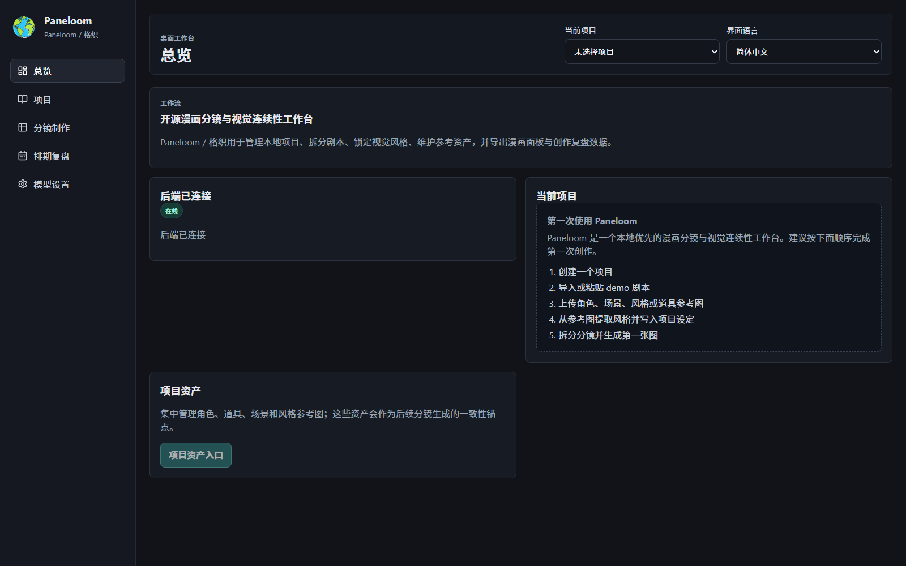

# Paneloom / 格织

[English](README.md) | **简体中文** | [日本語](README.ja.md) | [한국어](README.ko.md)

Paneloom 是一款 Windows 本地优先、面向单人创作者的 AI 漫画与动漫分镜桌面工具。它把剧本、角色与场景参考资产、视觉风格、分镜、图片版本、镜头锁定、导出和创作复盘组织在同一个可移动的本地项目中。

**关键词：** AI 漫画 · 动漫分镜 · 漫画创作 · 视觉连续性 · 本地优先 · Windows 桌面工具 · 图片生成 · FastAPI · React · pywebview

## 主要能力

- 导入或粘贴剧本，并拆分为可编辑分镜。
- 管理角色、场景、道具和风格参考图。
- 将 Bible、参考资产和视觉风格约束写入图片生成请求。
- 保存图片历史版本，选择最终版本，并批准和锁定镜头。
- 导出 JSON、CSV、XLSX、SRT、HTML、单张图片和漫画网格 PNG。
- 创建完整项目备份，并在不覆盖原项目的情况下恢复。
- 在离线状态下继续访问项目、剧本、分镜、历史图片和本地导出。

## 本地优先

项目和创作资产默认保存在用户选择的本地目录。API 密钥通过当前 Windows 用户的 DPAPI 加密保存，不会写入项目文件或前端 bundle。只有在用户主动运行 AI 功能时，必要的提示词或参考图才会发送给所配置的第三方模型服务。

## 当前状态

`0.1.0-beta.2` 是 Windows 本地桌面安全维护 Beta。它保留项目可移动性、备份恢复、production-like pywebview/WebView2 启动、随机回环端口和干净退出，并加强了项目路径、备份恢复和本地文件访问边界。软件不附带免费模型额度，需要用户自行配置兼容的文本和图片模型 API。

当前安装器尚未进行 Authenticode 签名，也尚未在独立干净的 Windows 10/11 机器完成最终验证，因此不应描述为正式签名发行版。

## 开源与参与

- 开源许可：[MIT License](LICENSE)
- 完整开发、构建和验证说明：[English README](README.md)
- 贡献指南：[CONTRIBUTING.md](CONTRIBUTING.md)
- 行为准则：[CODE_OF_CONDUCT.md](CODE_OF_CONDUCT.md)
- 安全政策：[SECURITY.md](SECURITY.md)
- 第三方许可：[THIRD_PARTY_LICENSES.md](THIRD_PARTY_LICENSES.md)
